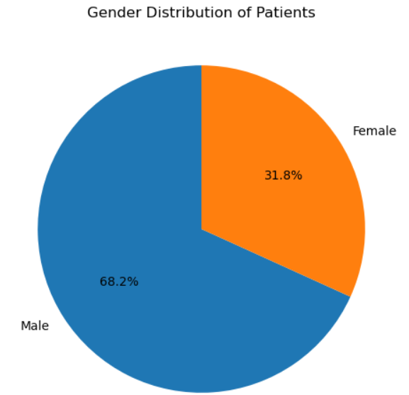

# Heart Disease Data Analysis - Exploratory Data Analysis (EDA)

**Pulse of Prevention: Analyzing Heart Health for Better Outcomes**

This project is an exploratory data analysis of patient data from a cardiology research institute. It is built for a fictional healthcare company, **HealthPulse Analytics**. The aim is to understand the factors linked with heart disease, describe high-risk patients and suggest preventive measures.

---

## Table of Contents
1. [Project Overview](#project-overview)
2. [Problem Statement](#problem-statement)
3. [Dataset](#dataset)
4. [Repository Structure](#repository-structure)
5. [Requirements](#requirements)
6. [Tools and Technologies](#tools-and-technologies)
7. [Project Workflow](#project-workflow)
8. [Visualizations](#visualizations)
9. [Key Insights](#key-insights)
10. [Challenges Faced](#challenges-faced)
11. [Recommendations](#recommendations)
12. [How to Run This Project](#how-to-run-this-project)
13. [Author](#author)

---

## Project Overview

HealthPulse Analytics provides data-driven insights to improve patient outcomes. The company received a heart disease dataset and asked me, as the data analyst, to find out what contributes to heart disease, who the high-risk patients are, and what can be done for early prevention.

I cleaned the data, answered the case study questions step by step in a Jupyter notebook, built a simple prediction model and wrote down my findings and recommendations.

**Main goals**
- Understand the patient profile (age, sex, blood pressure, cholesterol and more)
- Find which clinical measurements are most related to heart disease
- Compare patients with and without heart disease
- Build a simple logistic regression model to predict heart disease
- Give preventive recommendations for healthcare providers

**Stakeholders:** management team, healthcare providers, data analysts, patients, the cardiology research institute and healthcare policymakers.

---

## Problem Statement

The main challenge is to identify the key factors contributing to heart disease and to build a profile of high-risk patients, by looking at patient demographics, medical history and clinical measurements. HealthPulse Analytics wants to reduce the incidence of heart disease by finding high-risk factors and giving actionable insights for early intervention.

The full case study (background, data dictionary and all questions) is in `Problem_Statement.docx`.

---

## Dataset

- **Source:** [Heart Disease Dataset - Kaggle](https://www.kaggle.com/datasets/johnsmith88/heart-disease-dataset)
- **File:** `heart.csv`
- **Size:** 1,025 rows and 14 columns (302 unique patients after removing duplicates)

| Column | Description |
|---|---|
| age | Age of the patient |
| sex | Sex (1 = male, 0 = female) |
| cp | Chest pain type (0-3) |
| trestbps | Resting blood pressure (mm Hg) |
| chol | Serum cholesterol (mg/dl) |
| fbs | Fasting blood sugar > 120 mg/dl (1 = yes, 0 = no) |
| restecg | Resting electrocardiographic result (0-2) |
| thalach | Maximum heart rate achieved |
| exang | Exercise-induced angina (1 = yes, 0 = no) |
| oldpeak | ST depression induced by exercise relative to rest |
| slope | Slope of the peak exercise ST segment (0-2) |
| ca | Number of major vessels (0-3) colored by fluoroscopy |
| thal | Thalassemia (1 = normal, 2 = fixed defect, 3 = reversible defect) |
| target | Heart disease (1 = yes, 0 = no) |

---

## Repository Structure

```
heart-disease-data-analysis_EDA/
│
├── .gitignore
├── Age VS Cholesterol.png               # Chart: age vs cholesterol
├── Gender_Distribution_of_Patients.png  # Chart: gender distribution of patients
├── Heart_Disease_EDA.ipynb              # Complete analysis (cleaning, EDA, model, insights)
├── Problem_Statement.docx               # Case study and all questions
├── README.md                            # Project documentation (this file)
├── heart.csv                            # Dataset
└── requirements.txt                     # Python libraries needed
```

---

## Requirements

- Python 3.8 or higher
- Jupyter Notebook (or JupyterLab / VS Code with the Jupyter extension)
- Libraries (listed in `requirements.txt`):
  - pandas
  - numpy
  - matplotlib
  - seaborn
  - scikit-learn
  - scipy

Install them with:

```bash
pip install -r requirements.txt
```

---

## Tools and Technologies

| Tool | Use |
|---|---|
| Python | Main programming language |
| Pandas | Data cleaning, grouping, filtering and calculations |
| NumPy | Numerical operations |
| Matplotlib | Histograms, bar charts, pie chart, scatter plots and box plots |
| Seaborn | Pair plot and correlation heatmap |
| Scikit-learn | Logistic regression, train-test split, scaling and evaluation |
| SciPy | t-test to compare blood pressure of male and female patients |
| Jupyter Notebook | Writing code and explanations together |
| Git and GitHub | Version control and sharing the project |

---

## Project Workflow

**1. Understanding the data**
Checked the first and last rows, shape, columns, data types and summary statistics.

**2. Data cleaning**
- Checked for missing values (none found)
- Removed **723 duplicate rows**, which left 302 unique patients
- Replaced invalid codes (`thal = 0` and `ca = 4`) with the most common value of the column
- Added readable labels for sex and age groups
- Detected outliers with the IQR method and kept them, because they are real medical readings
- Created a min-max normalized copy of the clinical columns for fair comparison charts

**3. Analysis**
Answered 10 basic, 10 medium and 5 advanced questions, each with a chart or table and a short written insight. Topics include age, gender, blood pressure, cholesterol, blood sugar, chest pain types, heart rate, angina, ECG results, major vessels, thalassemia, risk factor combinations, correlation with the target, logistic regression and the ST slope.

**4. Findings and recommendations**
Summarized the key findings, gave recommendations and listed the limitations of the data.

---

## Visualizations

### Age vs Cholesterol


The correlation between age and cholesterol is only about 0.21, a weak positive link. Cholesterol goes up slightly with age, but there is a lot of spread at every age, and a few patients have very high cholesterol (one is above 550 mg/dl).

### Gender Distribution of Patients



**68.2%** of the patients are male and **31.8%** are female, so the data has roughly twice as many men as women.

---

## Key Insights

**Patient profile**
- The average age is **54.4 years**, and most patients are between 48 and 61.
- **68%** of the patients are male (206 men and 96 women).
- The average resting blood pressure is **131.6 mm Hg**, and 32% of patients have 140 or more.
- The average cholesterol is **246.5 mg/dl**, and 51% of patients have 240 or more.
- **14.9%** of patients have a high fasting blood sugar, and **32.8%** get angina during exercise.
- Chest pain type 0 is the most common (47%). Only 4 patients have a resting ECG result of 2.

**Relationships in the data**
- Cholesterol is only weakly related to age (correlation 0.21).
- There is no significant difference in blood pressure between men and women (p-value 0.318).
- Patients without exercise angina reach a higher maximum heart rate (156 bpm) than patients with angina (137 bpm).
- Fasting blood sugar barely separates the two target groups (55% vs 51%).
- The share of target = 1 patients drops sharply as the number of major vessels goes up (74% with 0 vessels, 32% with 1, 18% with 2 and 15% with 3).
- Among type 2 thalassemia patients 78% have target = 1, against 24% for type 3.
- Chest pain type 0 is more common with age (27% under 40 and 56% for 60 and above).

**What separates the two groups**
- The strongest correlations with the target are the **number of major vessels** (-0.46), **exercise angina** (-0.44), **chest pain type** (0.43), **oldpeak** (-0.43) and **maximum heart rate** (0.42).
- Cholesterol (-0.08) and fasting blood sugar (-0.03) are almost unrelated to the target.
- The group with target = 1 has a higher maximum heart rate (158 vs 139), a lower oldpeak (0.59 vs 1.59) and is a bit younger (52.6 vs 56.6).

**Prediction model**
- A logistic regression using all 13 features reaches **80% accuracy** on test data and **84%** in 5-fold cross-validation.
- The most important features in the model are the number of major vessels, chest pain type, sex and maximum heart rate.

> **Important note about the target column:** the group labelled target = 1 has a *higher* maximum heart rate, *less* angina, *lower* ST depression and *fewer* blocked vessels. This is the opposite of what is expected medically, and it is a known issue with this Kaggle dataset. I followed the data dictionary (1 = heart disease) but described the groups as "target = 1" in the notebook. If the coding is confirmed to be reversed, the conclusions simply swap sides.

---

## Challenges Faced

1. **Too many duplicate rows:** 723 of the 1,025 rows (about 70%) were exact duplicates. Keeping them would count the same patients again and again, so I removed them. This left only 302 patients, which is a small sample.
2. **Invalid codes:** `thal = 0` and `ca = 4` are not valid values according to the data dictionary. They were only a few rows, so I replaced them with the most common value.
3. **Reversed target coding:** Several well-known medical signs point in the opposite direction from the data dictionary. I compared the two groups, found the issue, documented it clearly and kept the wording neutral instead of ignoring it.
4. **Outliers in real medical data:** A few patients have extreme cholesterol or ST depression values. Removing them would hide the high-risk patients, so I kept them and used a normalized copy for comparisons.
5. **Different scales:** Cholesterol, blood pressure, heart rate and oldpeak are on very different scales, so I used min-max normalization for fair charts and standard scaling for the model.
6. **Codes that look like numbers:** Columns like `cp`, `sex` and `exang` are categories stored as numbers. I used crosstabs and group-wise percentages for these instead of averages.
7. **Messy charts with exact ages:** Grouping the chest pain types by every single age made an unreadable chart, so I created age groups (under 40, 40-49, 50-59, 60 and above).
8. **Survival question not possible:** The data has no survival, follow-up or date column, so survival rates by thalassemia type cannot be calculated. I clearly said this and showed the share of target = 1 patients by thalassemia type and age group instead.
9. **Small data for the model:** With only 302 patients the cross-validation results change from fold to fold (78% to 95%), so the model is only for learning and not for real medical decisions.

---

## Recommendations

**For healthcare providers and the company**
1. **Confirm the coding of the target column** with the cardiology institute before using the findings for decisions.
2. **Screen middle-aged and older patients** (50 and above) for blood pressure and cholesterol, because the average patient is already above the normal level for both.
3. **Give supervised, low-intensity exercise plans** to patients who get angina during exercise, since about 1 in 3 patients has it.
4. **Review the ECG signs together** - chest pain type, oldpeak, ST slope, number of vessels and maximum heart rate showed the strongest links, so they should be looked at together and not one at a time.
5. **Prioritize patients with 2 or more vessels** and patients with a reversible defect (thal = 3) for further tests and specialist care, after the target coding is confirmed.
6. **Keep lifestyle advice for everyone.** Cholesterol and blood sugar did not separate the groups here, but they are known medical risk factors and many patients are above normal levels.
7. **Use a simple risk score** (such as the number of risk factors) to flag high-risk patients early, and improve it later with a better model.

**For improving this project further**
- Use a bigger dataset without duplicates
- Add follow-up data (outcomes over time) so that survival can be studied
- Add lifestyle information such as smoking, diet and exercise habits
- Try other models (decision tree, random forest) and compare them with logistic regression
- Build an interactive dashboard (Power BI, Tableau or Streamlit)

---

## How to Run This Project

1. Clone the repository
   ```bash
   git clone https://github.com/ShubhamShah1/heart-disease-data-analysis_EDA.git
   cd heart-disease-data-analysis_EDA
   ```
2. Install the libraries
   ```bash
   pip install -r requirements.txt
   ```
3. Open the notebook (the dataset `heart.csv` is already in the folder)
   ```bash
   jupyter notebook Heart_Disease_EDA.ipynb
   ```
4. Run all the cells (Kernel > Restart & Run All).

---

## Author

**Shubham Shah**  
GitHub: [ShubhamShah1](https://github.com/ShubhamShah1)

If you liked this project, please give it a star.
